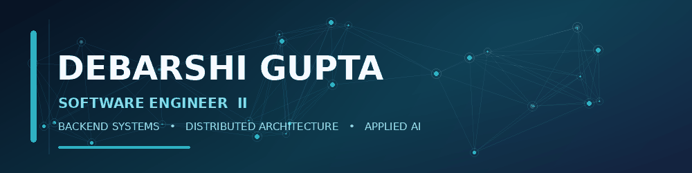
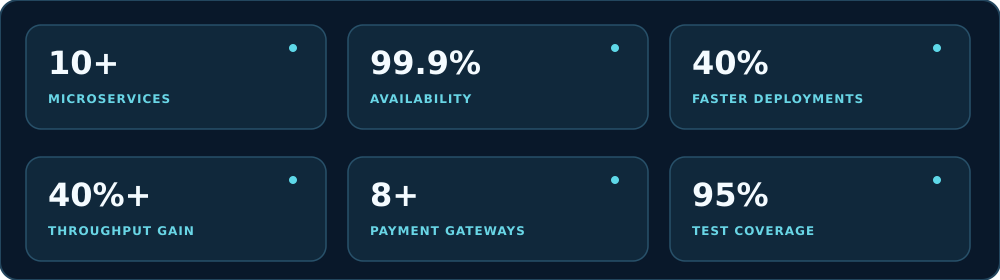
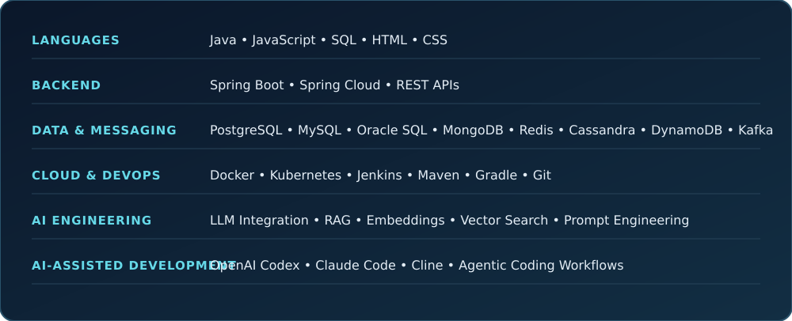

  <a href="https://www.linkedin.com/in/debarshi-gupta-9b242a210/">LinkedIn</a> &nbsp;·&nbsp;
  <a href="mailto:debarshigupta47@gmail.com">Email</a> &nbsp;·&nbsp;
  <a href="https://github.com/Debarshi-Gupta?tab=repositories">Repositories</a> &nbsp;·&nbsp;
  <a href="https://leetcode.com/u/hqueHB3BKy/">LeetCode</a> &nbsp;·&nbsp;
  <a href="https://debarshi-gupta.github.io">Portfolio</a>

---

## 🧭 Navigate

  <a href="#-about-me">About</a> &nbsp;◆&nbsp;
  <a href="#-engineering-focus">Focus</a> &nbsp;◆&nbsp;
  <a href="#-technology-stack">Tech stack</a> &nbsp;◆&nbsp;
  <a href="#-experience">Experience</a> &nbsp;◆&nbsp;
  <a href="#-featured-project">Project</a> &nbsp;◆&nbsp;
  <a href="#-github-activity">GitHub activity</a> &nbsp;◆&nbsp;
  <a href="#-lets-connect">Connect</a>

## 👋 About me

I'm a **Software Engineer II at Oracle** with **4+ years of software development experience**, building backend platforms, distributed services, and AI-enabled applications.

My core strength is backend engineering with **Java, Spring Boot, Spring Cloud, and event-driven architecture**. I also work on LLM-powered healthcare workflows involving **RAG pipelines, semantic retrieval, embeddings, and context-aware AI applications**.

I enjoy turning complex engineering problems into systems that are reliable, observable, scalable, and maintainable.

  
<strong>⚡ Engineering principles I value — expand</strong>

   

  - Clear service boundaries, API contracts, and pragmatic architecture.
  - Asynchronous workflows that improve decoupling and resilience.
  - Correctness, idempotency, testability, and failure handling.
  - Performance measured through latency, throughput, and reliability.
  - AI-assisted development with Codex, Claude Code, and Cline.

## 🎯 Engineering focus

<table>
  <tr>
    <td width="50%" valign="top">
      <h3>⚙️ Backend & distributed systems</h3>
      <ul>
        <li>Java, Spring Boot, and Spring Cloud</li>
        <li>Microservices and service communication</li>
        <li>Kafka-based event-driven processing</li>
        <li>API design, performance, and reliability</li>
      </ul>
    </td>
    <td width="50%" valign="top">
      <h3>🧠 Applied AI & RAG</h3>
      <ul>
        <li>LLM integration and prompt engineering</li>
        <li>Document ingestion and semantic chunking</li>
        <li>Embedding generation and vector indexing</li>
        <li>Hybrid retrieval and context optimization</li>
      </ul>
    </td>
  </tr>
  <tr>
    <td width="50%" valign="top">
      <h3>🚀 Performance & scale</h3>
      <ul>
        <li>Throughput and latency optimization</li>
        <li>Asynchronous processing pipelines</li>
        <li>SQL/NoSQL data access patterns</li>
        <li>Payment and healthcare workflows</li>
      </ul>
    </td>
    <td width="50%" valign="top">
      <h3>🧪 Engineering quality</h3>
      <ul>
        <li>Unit and integration testing</li>
        <li>Code quality and maintainability</li>
        <li>CI/CD and containerized services</li>
        <li>AI-assisted coding workflows</li>
      </ul>
    </td>
  </tr>
</table>

## 📊 Selected engineering outcomes

  

Selected results from different projects and roles; these figures are not a single combined system metric.

## 🧰 Technology stack

  

  
<strong>Explore the tools in more detail</strong>

   

  **Languages:** Java, JavaScript, SQL, HTML, CSS  
  **Frameworks:** Spring Boot, Spring Cloud, Angular, React  
  **Databases:** PostgreSQL, MySQL, Oracle SQL, MongoDB, Redis, Cassandra, DynamoDB  
  **Messaging:** Apache Kafka  
  **DevOps:** Git/GitHub, Maven, Gradle, Postman, Jenkins, SonarQube, Docker, Kubernetes  
  **AI engineering:** LLM integration, RAG pipelines, embeddings, semantic retrieval, prompt engineering  
  **AI-assisted development:** OpenAI Codex, Claude Code, Cline, agentic coding workflows

## 💼 Experience

  
<strong>Oracle</strong> · Software Engineer II · Bengaluru · Mar 2026 – Present

   

  - Design and build 10+ AI-enabled microservices using Java, Spring Boot, and Spring Cloud for healthcare workflows.
  - Develop end-to-end RAG pipelines covering document ingestion, semantic chunking, embedding generation, and vector indexing.
  - Integrate LLMs for clinical summarization, contextual question answering, and structured information extraction.
  - Build Kafka-driven asynchronous pipelines for document processing and vector database synchronization.
  - Optimize hybrid retrieval using vector similarity, metadata filtering, and SQL/NoSQL queries.
  - Contribute to systems maintaining 99.9% availability, with improvements in deployment time, throughput, and retrieval latency.

  
<strong>Juspay</strong> · Software Development Engineer · Kolkata · Nov 2024 – Mar 2026

   

  - Worked on **Hyperswitch**, a payment orchestration platform.
  - Integrated 8+ payment gateways across different platforms and payment methods.
  - Improved transaction processing speed and optimized high-load services.
  - Increased code coverage to 95% through unit and integration testing.
  - Refactored 5+ legacy modules used by 12+ engineers.

  
<strong>Cognizant</strong> · Programmer Analyst · Kolkata · Aug 2022 – Nov 2024

   

  - Developed Spring Boot microservices communicating through REST APIs and Apache Kafka.
  - Integrated REST/SOAP web services using JSON and XML data exchange.
  - Improved application performance through code refactoring and optimization.
  - Created 200+ JUnit/Mockito tests and improved code coverage.

## 🚀 Featured project

### 💳 [PayPal Clone](https://github.com/Debarshi-Gupta/paypal-clone)

A microservice-based payment application demonstrating wallet operations, idempotent transaction APIs, synchronous REST communication, and asynchronous Kafka event processing.

**Technology:** Java · Spring Boot · Apache Kafka · PostgreSQL · Redis · JWT · API Gateway

  <a href="https://github.com/Debarshi-Gupta/paypal-clone">View source code and implementation details →</a>

  
<strong>What the project demonstrates</strong>

   

  - Deposit and transfer APIs designed with idempotency in mind.
  - Synchronous REST communication between services.
  - Asynchronous Kafka event processing.
  - API gateway, rate limiting, and event-driven notifications.
  - Modular Spring Boot services backed by PostgreSQL and Redis.

## 📈 GitHub activity

  <picture>
    <source media="(prefers-color-scheme: dark)" srcset="./assets/contribution-snake-dark.svg" />
    
  </picture>

  <a href="https://github.com/Debarshi-Gupta?tab=repositories">📁 Browse repositories</a> &nbsp;·&nbsp;
  <a href="https://github.com/Debarshi-Gupta?tab=activity">🗓️ Recent activity</a> &nbsp;·&nbsp;
  <a href="https://github.com/Debarshi-Gupta?tab=stars">⭐ Starred projects</a>

  
<strong>How the contribution animation is generated</strong>

   

  The **Update contribution snake** workflow generates light and dark SVGs and commits them into this repository's `assets/` directory. It runs daily, on pushes to `main`, and can also be started manually from the repository's **Actions** tab.

## 🎓 Education

**B.Tech · Computer Science Engineering**  
Future Institute of Engineering and Management · Kolkata · Aug 2018 – Jul 2022  
**CGPA:** 9.18

## 🤝 Let's connect

I'm happy to connect with engineers, builders, and people working on backend systems, distributed architecture, or applied AI.

  <a href="mailto:debarshigupta47@gmail.com">✉️ Email</a> &nbsp;·&nbsp;
  <a href="https://www.linkedin.com/in/debarshi-gupta-9b242a210/">💼 LinkedIn</a> &nbsp;·&nbsp;
  <a href="https://debarshi-gupta.github.io">🌐 Portfolio</a> &nbsp;·&nbsp;
  <a href="https://leetcode.com/u/hqueHB3BKy/">🧩 LeetCode</a>

### Build things that scale. Keep learning. Stay curious.

